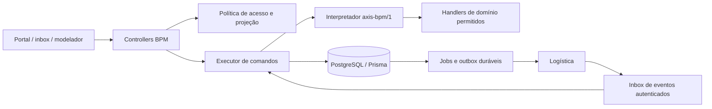

# Arquitetura decidida

## ADR-001 — Motor próprio limitado no monólito

Adotar `axis-bpm/1`, um interpretador determinístico de grafo declarativo executado no NestJS existente e persistido no mesmo PostgreSQL. Nenhum serviço novo de workflow, Redis ou broker é requisito do núcleo. Prisma permanece na versão do projeto; não atualizar stack como parte da reconstrução.

| Alternativa | Avaliação para este projeto | Decisão |
|---|---|---|
| Expandir `RequestsService` e seu JSON de aprovações | Mantém condições por categoria e mistura domínio, execução e UI; dificuldade já demonstrada no diagnóstico | Não seguir |
| Integrar motor externo de processos ou orquestração | Exigiria escolher produto, implantar runtime e adaptar identidade, tarefas e persistência; possível reavaliação para exigência futura de BPMN completo | Não adotar neste ciclo; não se afirma comparação de licenças ou benchmark |
| Motor próprio de subconjunto explícito | Permite transação única no Core e aproveita cadastros; custo aceito: construir/testar timers, junções e incidentes limitados | Escolhido |

É uma decisão de escopo, não afirmação de equivalência ao Lecom. Não há prova técnica executada nesta etapa. P01 deve demonstrar persistência após restart, concorrência, replay e troca de versão; P03 deve provar junção e quórum. Se qualquer gate falhar, Sol revisa o desenho antes de expandir o editor; Luna não improvisa outro motor.

Editor visual: `@xyflow/react` para desenhar nós/arestas e editar propriedades em P06. Não é executor. Fixar versão compatível com o lockfile em P06 e verificar integração com React instalado; o contrato não depende de tipos internos da biblioteca. A [documentação oficial React Flow](https://reactflow.dev/learn) descreve sua superfície de UI. Não oferecer importação/exportação BPMN nem usar ícones que prometam elementos não executáveis.

## Fronteiras

- `Request` continua identidade comercial, código e dados comuns; `RequestCategory` continua identidade do catálogo; `CategoryVersion` passa a guardar o snapshot completo. Não criar tabelas paralelas chamadas ProcessDefinition/FormVersion para os mesmos conceitos.
- Novo módulo `backend/src/request-processes/`: definição, validação, publicação, formulários, simulador e configurações. Novo `backend/src/request-runtime/`: comandos, política, tokens, atividades, SLA, jobs, incidentes e consultas.
- `backend/src/requests/` continua caminho legado e política compartilhada de anexos enquanto houver instâncias antigas. Novas execuções não chamam seus métodos de transição nem os caminhos especiais de compra.
- Domínio de compras em `backend/src/request-procurement/` normaliza itens/propostas e registra handlers; motor conhece `handlerKey`, nunca código/nome de categoria.
- Não alterar login, refresh, JWT, papéis globais ou cadastros para acomodar um processo. Uma política local lê estado atual de User, RolePermission e Collaborator em cada comando BPM, pois claims JWT podem permanecer antigos após revogação. Mantém-se o guard existente; o segundo controle de permissão BPM usa dados atuais.
- Sem entidade Company/Unit no schema atual: o primeiro ciclo é uma única organização Axis. Não inventar `companyId`/`unitId` livre no JSON nem prometer isolamento multiempresa. Expansão exige projeto separado dos cadastros e testes de tenant.

## Contrato do grafo e capacidades

Snapshot `format: "axis-bpm/1"` contém `capabilities`, `nodes`, `edges`, `form`, `policy`, `calendar`, `sla`, `authority`, `handlers`, `tests`. IDs de nós/campos/arestas estáveis dentro da versão. UI de posicionamento fica em `editorLayout`; é incluída na publicação, mas não influencia execução.

| Nó | Semântica fechada | Pacote |
|---|---|---|
| `start` | Único início, uma saída; criado no submit | P01 |
| `human` | Uma tarefa de triagem ou execução; candidata a uma fila ou ator explícito; claim antes de executar; resultado `complete` | P01 |
| `end` | Terminal sem saída, `terminalOutcome=completed/rejected`; exatamente um fim de sucesso e, a partir de P03, finais reprovados opcionais; sucesso só sem bloqueios | P01 |
| `approval` | Atividade de grupo com slots, rodada, snapshot e quórum; arestas approve/reject e política return explícita fora das arestas | P03 |
| `exclusive` | Condições ordenadas com primeira verdadeira e saída default obrigatória | P03 |
| `parallelSplit` / `parallelJoin` | Fork estruturado de TODOS os ramos; join aguarda todos pela correlação do fork | P03 |
| `service` | Cria job de handler registrado; sucesso só por resultado persistido; erro gera retry/incidente | P04/P07 |
| `timer` | Persiste job para instante/tempo útil definido; segue uma saída quando vence; não executa em memória | P05 |
| `acceptance` | Tarefa do solicitante com aceitar/contestar; usa política de encerramento | P05 |

Publicação rejeita capacidades não disponíveis no backend. P01 só aceita `start/human/end` e no máximo uma atividade ativa. Versões futuras podem usar mais capacidades sem mudar as antigas.

Limites v1: 100 nós, 200 arestas, 200 campos, 200 linhas por tabela de formulário, 20 ramos paralelos, 100 slots de aprovação por atividade, 64 níveis de hierarquia, 50 transições automáticas por comando. Limites documentados e validados, não truncados silenciosamente. Grafo acíclico dentro de um ciclo; fork/join estruturados, aninhamento máximo 3. Devolução e reabertura iniciam novas rodadas/ciclos via comandos; não são arestas arbitrárias de retorno. Sem gateway inclusivo, eventos de borda, multi-instância dinâmica, subprocesso recursivo, scripts, chamadas HTTP arbitrárias, execução por e-mail ou migração de instância aberta.

Validador prova: um start e exatamente um end completed, todos alcançáveis; end rejected opcionais só desde P03; nós sem saída proibidos salvo end; IDs únicos; todos os caminhos normais chegam a um end; resolutores compatíveis; condições e bindings tipados; joins correspondem aos splits e ramos não escapam da barreira; cada approval tem destinos e returnPolicy; regras financeiras não têm lacunas/sobreposições no domínio configurado. Resultado tem erros por nó/campo/aresta, não apenas `false`.

Return não é aresta para trás: `returnPolicy` define `restartNodeId` anterior válido no mesmo bloco e campos corrigíveis. O comando fecha a rodada e cria tarefa de correção; resubmit abre nova ativação do escopo, com tokens/decisões anteriores superados. Em paralelo, v1 devolução/rejeição é do ciclo inteiro: cancela ramos ainda sem efeito e retém barreira de compensação para efeitos já confirmados, sem reiniciar só um ramo arbitrário. End rejected finaliza o ciclo como reprovado apenas após compensações obrigatórias; não passa pelo end completed. P03 não oferece rejeição local com propagação customizada entre ramos.

## Condições e formulários

AST permitido: `and`, `or`, `not`, `eq`, `neq`, `gt`, `gte`, `lt`, `lte`, `in`, `exists`. Operandos são `{path}` e `{literal}`. Caminhos permitidos: `request.*`, `fields.<key>`, `procurement.*`, `context.*` fornecido pelo servidor. Sem JS, `eval`, SQL, regex livre, funções ou acesso a ambiente. Profundidade 10, 100 operações por expressão; tipo incorreto gera erro de validação/publicação. Valor ausente não equivale a zero; só `exists` o aceita sem erro. Uso de campo oculto em condição não devolve seu valor ao cliente.

O mesmo snapshot tipado fornece validação no servidor e apresentação no React. Não confiar em validação do browser. Fontes são registradas por chave (`projects`, `cost_centers`, `collaborators`, `clients`, `job_titles`, depois `logistics.materials`); servidor filtra projeção e permissão. Não conceder leitura de dados médicos de colaborador para popular um select. Fontes ausentes ficam indisponíveis e impedem o envio quando obrigatórias.

## Execução transacional

1. Autenticar; resolver permissões atuais e escopo. Preflight de autorização antes de eventual resposta de replay.
2. Abrir transação curta; adquirir/consultar recibo idempotente; bloquear linha Request por `SELECT ... FOR UPDATE` parametrizado; reler versão, acesso e estado dentro da transação.
3. Comparar `expectedVersion`, validar formulário/atividade, gravar decisão/dados e consumir token. Nunca verificar apenas fora da transação.
4. Avançar nós automáticos até aguardar humano/job/timer ou fim, respeitando limite. Criar participantes, relógios e jobs necessários.
5. Atualizar resumo de Request, incrementar uma vez `lockVersion`, gravar eventos com sequência, notificações/outbox e recibo na MESMA transação. Qualquer erro desfaz tudo.
6. Commit; devolver DTO filtrado. Não fazer HTTP, esperar scanner ou enviar e-mail mantendo o lock.

Bloqueios de linha são parte do PostgreSQL 16 ([referência oficial](https://www.postgresql.org/docs/16/explicit-locking.html)). Para workers, `FOR UPDATE SKIP LOCKED` permite separar jobs concorrentes; seu uso é restrito à seleção de fila, conforme [SELECT do PostgreSQL 16](https://www.postgresql.org/docs/16/sql-select.html). Não aplicar SKIP LOCKED em consultas de negócio. Implementação usa API `$transaction` e cliente instalados (Prisma 5.22); documentação web de Prisma atual pode corresponder a versão posterior e não autoriza copiar outra API.

Todos os escritores BPM — comentários/anexos, worker, aprovação, SLA, cancelamento e reabertura — seguem lock Request antes de filhos. Em comandos com mais de uma Request, bloquear IDs em ordem lexical. Deadlock/transação abortada permite no máximo três tentativas internas com jitter; colisão de versão esperada continua 409, sem retry automático do comando com dados novos.

Job contém estado, lease/owner, tentativa e próxima data. Worker retoma após restart e lease expirado. Uma chave de efeito impede job/resultado duplicado. Falha automática vira incidente tratável, não aprovação/conclusão fictícia. Reprocessamento reusa efeito e exige autorização.

## Estado comercial e execução

Request.status é projeção persistida do estado do ciclo; não é API livre de escrita. A fonte operacional é ProcessInstance + atividades/tokens. `lockVersion` em Request é única versão de concorrência da instância; não criar um segundo contador concorrente em ProcessInstance. Múltiplas atividades são exibidas individualmente; status agregado não tenta representar todos os responsáveis. `assigneeId` é apenas coordenador quando houver paralelismo.

Medições, histórico e anexos usam os IDs existentes. Eventos de runtime em tabela própria, com DTO de timeline; AuditLog continua auditoria genérica do Axis. Não replicar dados completos sensíveis em duas trilhas.

## Substituição e retorno

Flag de habilitação por processo no servidor; front lê capacidades do servidor. P01 roda em rota BPM de teste. Versões legadas e instâncias existentes permanecem identificadas `legacy`; novas são `bpm_v1`. Um registro tem um executor apenas. Jobs legados devem excluir explicitamente BPM.

Em P08, habilitar novas aberturas por categoria e trocar o portal para BPM. Histórico antigo permanece disponível. Não construir camada ampla de compatibilidade dos comandos antigos: mutação antiga sobre BPM responde 409 `WRONG_EXECUTOR` e o novo comando sobre legado também. Link de leitura direciona para a tela correta. Reversão desabilita novas aberturas da versão defeituosa, preserva instâncias e efeitos externos; nunca restaura banco por cima de compras/entregas feitas. Retirada física do legado fica para entrega separada, após inventário e autorização específica se envolver dados.
