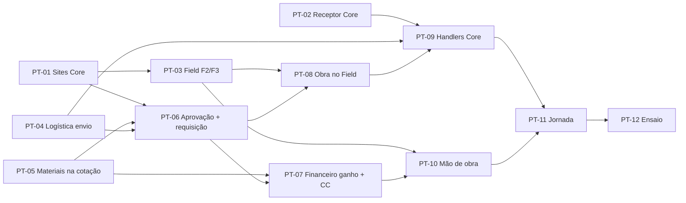

# Plano: do projeto aprovado à obra no Field

Escrito em 2026-11-08 como planejamento. **Situação em 2026-11-08 (fim do dia): PT-01 a PT-11 implementados**
na branch `integracao/ponta-a-ponta` (sem push) e ensaiados ponta a ponta (PT-12, abaixo). Cada PT foi feito
numa sessão do Sonnet 5.5 (§7).

Objetivo do dono do produto: cadastrar o projeto no Core, cotar no Financeiro e, quando o cliente
aprovar o orçamento, disparar tudo sozinho:

1. requisição de material à Logística, aprovada pelo responsável do centro de custo (CC), para enviar
   ao site os materiais orçados;
2. receita e custos do projeto (material, mão de obra, compras, despesas) lançados no CC certo, com
   cotado × realizado;
3. obra criada no Axis Field com site, datas, responsável, equipe prevista e tarefas geradas da SOW.

Respostas do dono em 2026-11-08 que fixam o desenho (as demais decisões, PA-05 a PA-19, estão na §3 e
também foram confirmadas no mesmo dia):

| # | Decisão |
|---|---|
| PA-01 | O gatilho é o **status do projeto no Core**: o comercial muda de `proposta` para `aprovado`. |
| PA-02 | A requisição de material é **automática e passa pela aprovação do responsável do CC** (para ficar registrado). |
| PA-03 | O Field já tem o **fluxo guiado da SOW** (Importar → Revisar → Templates → Gerar → Enviar ao projeto); a automação usa esse fluxo, não um parser novo. |
| PA-04 | O Field é o código em `lgc-dev-field/` da branch `rafaelbaladioffa-ctrl/axis-field` (worktree `.claude/worktrees/axis-field`), ainda **não integrada** a esta branch. Contrato atual: `docs/integracao-core-field.md` daquela branch. |

## 1. Visão do fluxo

```mermaid
sequenceDiagram
    autonumber
    participant Com as Comercial (Core)
    participant Core
    participant Fin as Financeiro
    participant Log as Logística
    participant Fld as Field

    Com->>Core: cria projeto (cliente, site, CC, responsável) + SOW + Bid Template
    Com->>Core: Solicitar cotação
    Core-->>Fin: project.quote_requested (existe)
    Fin-->>Core: POST /integration/projects/:id/quotes (equipe, dias, Bid + MATERIAIS novos)
    Com->>Core: Aprovar projeto (revisão aceita, PO do cliente)
    Note over Core: mesma transação: status aprovado,<br/>aceite, requisição de envio, outbox
    Core-->>Fin: project.approved
    Core-->>Fld: project.approved
    Fin->>Fin: revisão vira "ganha" + lançamentos comprometidos no CC
    Fld->>Core: baixa a SOW (API key)
    Fld->>Fld: cria a obra, roda o fluxo guiado da SOW, gera tarefas
    Core->>Core: responsável do CC aprova a requisição de envio
    Core-->>Log: material_request.approved (itens, site, endereço, data)
    Log->>Log: reserva, separa, expede ao site, confirma entrega (baixa com CC e projeto)
    Log-->>Core: shipment.dispatched / delivery.confirmed (receptor novo)
    Fld-->>Core: field.project.started / progress / completed (receptor novo)
    Fin->>Log: consumo por CC e projeto (API key, existe; passa a ser automático)
    Fin->>Fld: horas reais por técnico e projeto (API key, nova)
    Fin->>Fin: realizado do projeto no CC (material, mão de obra, compras)
```

## 2. O que já existe e o que falta

| Etapa | Já existe | Falta |
|---|---|---|
| Projeto no Core | Cliente, CC, responsável, datas, SOW e Bid Template versionados, status `proposta → aprovado → em_execucao → encerrado` | **Site** (o Core não tem cadastro de site; o endereço só existe no cliente). Aceite: qual revisão o cliente aprovou e o PO. |
| Cotação | Pedido e devolução Core ↔ Financeiro (equipe por função × dias, Bid). No Financeiro, materiais com quantidade, preço cobrado e custo real em `inputs`. | Material da cotação **sem vínculo** com o catálogo da Logística (decisão P-06 não implementada). Materiais **não vão** ao Core. O modelo `generico` não devolve nada ao Core. |
| Cliente aprovou | Status `ganha` da revisão no Financeiro (manual, sem evento). Status `aprovado` do projeto no Core (manual, sem efeito). | Ligar os dois: o Core avisa (`project.approved`) e o Financeiro marca `ganha` sozinho. |
| Requisição à Logística | Na Logística: ordem de atendimento, reserva, separação, expedição, prova de entrega e baixa `SAIDA_ENTREGA` com CC e projeto; o adaptador já entende `material_request.approved/changed/cancel_requested`. No Core: aprovação pelo responsável do CC (`centro_custo`) na compra. | O Core **não emite** `material_request.*`. Não há tipo de requisição "envio de material para obra". A ordem da Logística não tem destino/endereço. O `averageCost` é estático (baixa pode valer 0). Sem receptor no Core para acompanhar a entrega. |
| CC e resultado | `cc_entries` no Financeiro (append-only, com `projectAxisId`): compras, reembolsos, adiantamentos, consumo da Logística (importação manual mensal), folha por CC do colaborador, receita só manual. | Comprometido do projeto na aprovação. Mão de obra **por projeto** (hoje a folha vai só ao CC do colaborador). Importação automática. PJ5 (realizado) não existe e planejava um livro paralelo. |
| Obra no Field | Projeto, tarefas, despacho, HH real por técnico, sites, fluxo guiado da SOW (parser determinístico + IA opcional). Login pelo Core (F1). | Webhooks e casamento de cadastros (F2/F3). Criar obra a partir do Core (F4). SOW em PDF baixada do Core. Equipe prevista. Exportar HH para o Financeiro. Avisar o Core (F5). |
| Retorno ao Core | — | Receptor de eventos dos satélites (`POST /integration/inbound`): pré-requisito comum a Logística, Field e Financeiro. |

## 3. Decisões de desenho

**Todas confirmadas pelo dono em 2026-11-08.** A PA-05 revisa a FD-02 de `docs/integracao-core-field.md`
(branch `rafaelbaladioffa-ctrl/axis-field`); atualizar aquele documento no PT-03.

| # | Decisão | Por quê | Afeta |
|---|---|---|---|
| PA-05 | **Site vira cadastro do Core** (`sites`, ligado ao cliente: código como `GRU53`, nome, endereço, cidade, UF, latitude/longitude). Projeto tem `site_id`, obrigatório para aprovar. Eventos `site.created/updated`. O Field casa os sites dele por `axis_site_id` e continua dono de localizações internas (sala, rack). | Logística precisa do endereço de entrega, Financeiro lê o site da SOW, Field precisa do site da obra; os três precisam do mesmo site. **Revisa a FD-02** (que deixava site só no Field). | PT-01, PT-03, PT-08 |
| PA-06 | **Um projeto = um site = uma obra no Field.** Proposta com vários sites vira vários projetos no Core. | Simplifica CC, requisição e obra; o Field §4 deixava isso em aberto. | PT-06, PT-08 |
| PA-07 | Aprovar o projeto exige: site, **revisão de cotação aceita** (padrão: a vigente) e, opcional, nº do PO e o PDF do PO (novo tipo de documento `po`). | Sem saber qual revisão o cliente aceitou, não há materiais, equipe nem valor contratado. | PT-06 |
| PA-08 | Todo material da cotação precisa ter **código da Logística** (`Material.code`) para a revisão ser aprovada para envio no Financeiro. Material novo é cadastrado antes na Logística. | Sem código não dá para reservar nem expedir. A alternativa (itens sem código virando compra) fica para depois. | PT-05 |
| PA-09 | Nova categoria de requisição no Core, `kind = envio_material` ("Envio de material para obra"). **Solicitante = usuário de sistema "Axis (automático)"**, sem beneficiário; o responsável do projeto vai como **recebedor no site**. Aprovação: responsável do CC do projeto; sem ele, o do CC pai; sem nenhum, fica `aguardando_aprovacao` com alerta ao admin de Requisições. | Com o responsável do projeto como solicitante, a regra de conflito o tira da cadeia e a requisição fica sem aprovador quando ele também é o responsável do CC. | PT-06 |
| PA-10 | **Data de necessidade** = início previsto da cotação aceita − 5 dias úteis (configurável). Origem do material: almoxarifado padrão (`DEFAULT_WAREHOUSE_CODE`) até existir regra por região. | Logística precisa de prazo e origem. | PT-06, PT-04 |
| PA-11 | Material faltante: a ordem fica `AGUARDANDO_ESTOQUE` na Logística e o Core mostra isso na requisição. **Compra automática do faltante fica fora** desta entrega (Suprimentos abre a compra). | Evita duplicar a decisão de compra antes de o fluxo básico rodar. | PT-04, PT-09 |
| PA-12 | Material vai **direto ao site** e é baixado na entrega (`SAIDA_ENTREGA` com CC e projeto). Transferência para almoxarifado de obra não é usada neste fluxo. | É o que o relatório de consumo por CC já soma; a transferência não leva CC. | PT-04 |
| PA-13 | **Comprometido na aprovação:** o Financeiro lança, no CC do projeto e com o projeto, a receita contratada (valor da revisão ganha) e os custos orçados por categoria (mão de obra, material, frete, outros). O realizado substitui o comprometido conforme os lançamentos chegam. | É o "quanto ganhamos e quanto vamos gastar" desde o primeiro dia. | PT-07 |
| PA-14 | **Mão de obra realizada = horas reais do Field (HH por técnico) × custo hora médio da função** (regra da PJ5: nunca por salário individual). Cada importação gera **par de lançamentos**: custo no CC do projeto (com o projeto) e crédito "mão de obra transferida" no CC de origem do técnico (ex.: `DC-001-JAI`). | A folha inteira já cai no CC do técnico; o par evita contar duas vezes. Se o CC do projeto é o mesmo da equipe, o total do CC não muda, mas o projeto passa a mostrar a mão de obra dele. As horas não usadas em projeto ficam como ociosidade no CC da equipe. | PT-10 |
| PA-15 | **Receita realizada** continua lançamento manual de faturamento (com o projeto) até existir contas a receber. | O Axis ainda não emite nem registra nota de serviço. | PT-07 |
| PA-16 | Um único livro: o realizado da PJ5 **lê os `cc_entries` do projeto**, sem tabela `actual_cost_entries` paralela. | Duas fontes de custo divergem. | PT-07, PT-11 |
| PA-17 | No Field, a obra nasce com status `planning` em `project.approved`. A SOW roda **só com o parser determinístico** (IA desligada no modo automático). Se todos os itens forem resolvidos sem aviso, aprova, gera e envia as tarefas ao projeto sozinho; senão para na etapa pendente do fluxo guiado e notifica o responsável. | Respeita a regra do Field "a IA nunca grava sem revisão humana" e não grava tarefa errada sem ninguém ver. | PT-08 |
| PA-18 | O Core passa o projeto a `em_execucao` quando o Field avisa a primeira tarefa iniciada (`field.project.started`); `field.project.completed` só alerta o responsável (encerrar continua manual). | Status do Core passa a refletir o campo sem ninguém lembrar de mudar. | PT-09 |
| PA-19 | Revisão nova depois da aprovação (aditivo) **fica fora**: muda-se à mão (requisição complementar e lançamento manual). | Reduz o escopo da primeira entrega. | — |

## 4. Contratos novos

Convenções de [integracao-centros-de-custo.md](integracao-centros-de-custo.md): valores como string
decimal com 2 casas, datas `AAAA-MM-DD` (São Paulo), instantes ISO 8601. Envelope e assinatura dos
eventos do Core como hoje (`{event_id, event_type, occurred_at, payload}`, `X-Axis-Signature`).

### 4.1 Materiais na devolução da cotação (Financeiro → Core)

`POST /api/v1/integration/projects/:id/quotes` ganha `materials[]` (opcional para não quebrar
cotações antigas; obrigatório no Financeiro a partir da PA-08):

```json
"materials": [
  { "material_code": "RED-CAB-0123", "description": "Cabo óptico 12F", "unit": "m", "quantity": "1200.000" }
]
```

Sem custo nem preço (regra do contrato: nada de custo vai ao Core). Core grava em
`project_quote_materials` (`project_quote_id`, `material_code`, `logistics_material_id` resolvido no
servidor, `description`, `unit`, `quantity`). `material_code` repetido → `400`. O modelo `generico` do
Financeiro passa a devolver a cotação também.

### 4.2 Aprovação do projeto (Core)

`PUT /projects/:id/status` com `status: "aprovado"` passa a aceitar e validar `acceptedQuoteId`
(padrão: a cotação vigente), `clientPoNumber?` e exige `site_id` no projeto. Numa transação:

1. status `aprovado` e `project_acceptances` (`project_id`, `project_quote_id`, `client_po_number`,
   `accepted_by_user_id`, `accepted_at`);
2. requisição `envio_material` com os itens de `project_quote_materials` e a linha de aprovação
   (PA-09); `requests.origin = 'projeto_aprovado'` e `source_ref = project_quote_id` únicos (aprovar de
   novo não duplica);
3. outbox: `project.status_changed` (existe), `project.approved` e `request.submitted`.

Sem materiais na cotação aceita, o projeto é aprovado e a requisição não é criada (aviso na tela).

**Evento `project.approved`:** estado completo do projeto (como todo `project.*`) mais `site`
(`site_id`, `code`, `name`, endereço completo, `latitude`, `longitude`), `accepted_quote`
(`project_quote_id`, `external_revision_id`, `revision_number`, `work_days`, `planned_start_date`,
`planned_end_date`, `team[]` da cotação, `sow_document_id`), `client_po_number`,
`material_request_id` (ou `null`), `approved_by_user_id`, `approved_at`. Assinantes: Financeiro e Field.

### 4.3 Requisição de envio → Logística (Core → Logística)

Quando a requisição `envio_material` é aprovada, o Core emite `material_request.approved` no formato do
adaptador que a Logística já tem (`material-request.adapter.ts`), com campos novos de destino:

```json
{
  "request_id": "<uuid>", "version": 1, "code": "REQ-…",
  "project_id": "<uuid>", "cost_center_id": "<uuid>",
  "requester_id": null, "recipient_id": "<colaborador responsável do projeto>",
  "warehouse_code": null, "needed_by": "2026-11-24",
  "destination": { "site_id": "<uuid>", "site_code": "GRU53", "address": "…", "city": "…", "state": "SP",
                   "latitude": -23.4, "longitude": -46.5 },
  "items": [ { "material_code": "RED-CAB-0123", "quantity": "1200.000" } ]
}
```

Cancelar a requisição aprovada emite `material_request.cancel_requested`. A Logística passa a assinar
`material_request.*` e `site.*`.

### 4.4 Receptor de eventos dos satélites (Satélite → Core)

`POST /api/v1/integration/inbound`: identifica o satélite pela API key, confere a assinatura HMAC do
corpo com o segredo do satélite (aceitar os cabeçalhos atuais `X-Logistica-Signature` e
`X-Financeiro-Signature` e o novo `X-Field-Signature`), deduplica por `Idempotency-Key`/`event_id` numa
tabela `integration_inbox` e despacha para handlers por `event_type`. Evento sem handler: `202` e
guardado como ignorado. Primeiros handlers:

| Evento | Origem | Efeito no Core |
|---|---|---|
| `fulfillment.created` | Logística | requisição de envio → `em_atendimento`, guarda o código da ordem |
| `shipment.dispatched` | Logística | → `aguardando_entrega`, comentário "Expedido para o site" |
| `delivery.confirmed` / `delivery.partial` / `delivery.refused` | Logística | encerra / mantém com parcial / comentário de recusa |
| `field.project.created` | Field | guarda o id e o link da obra no projeto |
| `field.project.started` | Field | projeto `aprovado → em_execucao` (PA-18) |
| `field.project.progress` | Field | % de avanço e HH real × orçado no projeto |
| `field.project.completed` | Field | alerta o responsável do projeto |

**Formato real dos eventos do Field (PT-08, implementado):** envelope `{event_id, event_type, occurred_at, source: "field", payload}`,
cabeçalhos `Idempotency-Key` (= `event_id`), `X-Field-Signature: sha256=<hmac do corpo>` e, **além do previsto**,
`Authorization: Bearer <API key>` (o guard do Core então confere a assinatura contra o segredo daquele satélite).
Payloads, todos com `axis_project_id` e `field_project_id`: `field.project.created` (`field_project_code`, `url`, `status`,
`sow_plan_status` = `generated` | `pending_review` | `failed` | `no_sow`, `tasks_count`, `created_at`),
`field.project.started` (`started_at`), `field.project.progress` (`date`, `percent_complete`, `tasks_total`, `tasks_done`,
`real_man_hours`, `planned_man_hours`) e `field.project.completed` (`completed_at`). O `created` sai depois do plano da SOW
(para já trazer a situação final). Detalhes: [integracao-core-field.md §5](integracao-core-field.md#5-f5--field--core-pt-08).

### 4.5 Horas reais do Field (Financeiro ← Field)

Mesmo padrão do consumo da Logística (API por `X-Api-Key`):
`GET /api/integration/labor-hours?from=AAAA-MM-DD&to=AAAA-MM-DD` →
`[{ axis_project_id, axis_collaborator_id, date, hours, adjusted }]`, com `hours` =
`real_man_hours` (regra 1 do Field: soma das horas reais de cada técnico, descontadas pausas). Só
projetos com `axis_project_id`. Horas da planilha do supervisor ficam de fora (regra 9).

## 5. O que cada sistema muda

**Core:** cadastro de sites; site, aceite e PO no projeto; materiais na cotação; categoria
`envio_material` e criação automática; eventos `project.approved`, `site.*`, `material_request.*`;
consulta de preço na Logística no servidor; receptor `integration/inbound`; painel "Jornada do projeto".

**Financeiro:** código da Logística no material da cotação; materiais na devolução; `project.approved`
→ revisão `ganha` + comprometido; importação automática do consumo da Logística e das horas do Field;
par de lançamentos de mão de obra; realizado da PJ5 lendo `cc_entries`.

**Logística:** destino na ordem e no romaneio; assinar `material_request.*` e `site.*`; custo médio
móvel no recebimento; rota por API key para o Core consultar materiais e custo; enviar
`fulfillment/shipment/delivery` ao Core.

**Field:** F2/F3 (webhooks, `axis_*_id`, carga inicial e casamento de cadastros); criar obra em
`project.approved`; baixar a SOW em PDF do Core e rodar o fluxo guiado; equipe prevista na obra;
`GET /api/integration/labor-hours`; eventos ao Core.

## 6. Pacotes de trabalho

Regra do [AGENTS.md](../AGENTS.md): um commit e um PR por escopo. Mudança de contrato entre dois
sistemas pode ir junto, dita na mensagem. Cada PT termina com testes, a verificação do AGENTS.md e os
documentos de estado atual atualizados.

### Onda 1 — fundações (podem correr em paralelo)

**PT-01 · Core · Sites e site no projeto** (PA-05)
- Prisma: `sites` (`client_id`, `code` único por cliente, `name`, endereço, `latitude`, `longitude`,
  `active`); `projects.site_id` nulo (obrigatório só para aprovar). Migração nova.
- CRUD `/sites` com `@RequirePermissions('site:*')` e `@AuditAction`; seleção de site na tela do
  projeto, filtrada pelo cliente; aba Sites na tela do cliente.
- Eventos `site.created/updated` na mesma transação; `site_id` em todo `project.*`; incluir sites no
  `resync-master-data`.
- Docs: `dominio/cadastros.md` (seção nova), `integracao-*` (eventos).
- Pronto quando: projeto salva site do mesmo cliente; site de outro cliente → `400`; eventos no outbox.

**PT-02 · Core · Receptor de eventos dos satélites** (§4.4)
- `integration_inbox` (`satellite_id`, `event_id` único por satélite, `event_type`, `payload`,
  `status` `processed|ignored|failed`, `error`, `received_at`); controller sem JWT, guard de API key +
  HMAC; registro de handlers por tipo (começa vazio, só guarda).
- Tela Integrações: lista das últimas mensagens recebidas com status.
- Testes: assinatura errada `401`; repetida devolve o mesmo resultado sem reprocessar; sem handler `202`.
- Docs: `arquitetura.md §6`, os três `integracao-*`.

**PT-03 · Field · F2/F3 (cadastros do Core)** — na branch `rafaelbaladioffa-ctrl/axis-field`
- Conforme `docs/integracao-core-field.md §3` daquela branch, mais `site.*` (PA-05):
  `axis_collaborator_id`, `axis_client_id`, `axis_project_id`, `axis_site_id` (aditivos, nulos);
  receptor `POST /api/v1/webhooks/axis` com HMAC e deduplicação; `manage.py axis_sync` com relatório dos
  sem par.
- Testes Django em banco `_test`.

**PT-04 · Logística · Receber envio para obra** (PA-10, PA-11, PA-12)
- `FulfillmentOrder`: `destination_site_axis_id`, `destination_text`, `destination_lat/lng`; o adaptador
  lê `destination`; `Shipment.destination` vem preenchido da ordem.
- Assinar `material_request.*` e `site.*` (cache do site).
- **Custo médio móvel** no recebimento (`averageCost` recalculado; `lastCost` atualizado), com teste.
- Rota por `X-Api-Key`: `GET /integration/materials?codes=…` → `id`, `code`, descrição, unidade,
  `averageCost`, disponível.
- Garantir `fulfillment.created`, `shipment.dispatched`, `delivery.*` no outbox com `axis_request_id`.

**PT-05 · Financeiro + Core · Materiais na cotação** (PA-08, §4.1) — mudança de contrato
- Financeiro: `logistics_material_code` no material da cotação (P-06), escolhido do catálogo da
  Logística (`LOGISTICA_API_URL`); bloqueio no `approve_send` se faltar; `materials[]` em
  `core-quote.ts`; modelo `generico` passa a devolver a cotação.
- Core: DTO aceita `materials[]`; tabela `project_quote_materials`; seção da cotação mostra os materiais.
- Docs: `integracao-core-financeiro.md §4`, `dominio/cadastros.md §10.2`, `projetos-especificacao.md`.

### Onda 2 — aprovação e requisição

**PT-06 · Core · Aprovar projeto e requisição automática** (PA-07, PA-09, PA-10, §4.2, §4.3)
Depende de PT-01 e PT-05 (PT-04 para o preço; sem ele, valor estimado zero e aviso).
- Usuário de sistema "Axis (automático)" no seed e na migração.
- `project_acceptances`; tipo de documento `po`; diálogo "Aprovar projeto" (revisão aceita, PO, site).
- Categoria `envio_material` (seed + `category-kind.ts`); criação na transação da aprovação;
  `requests.origin` + `source_ref` com índice único; valor estimado = Σ quantidade × `averageCost`
  consultado na Logística no servidor.
- Aprovação `centro_custo` (reaproveitar a da compra) com o fallback da PA-09; ao aprovar, emitir
  `material_request.approved`; ao cancelar aprovada, `material_request.cancel_requested`.
- Detalhe da requisição: itens, site e endereço, data de necessidade, situação na Logística.
- Testes no estilo de `requests-fluxo.spec.ts`: aprovação cria uma requisição só (idempotente),
  responsável do CC = responsável do projeto continua aprovando, sem materiais não cria, cancelamento
  emite o evento.
- Docs: `dominio/cadastros.md §10`, `dominio/requisicoes-estado-atual.md` (seção nova e §13),
  `integracao-core-logistica.md §3`.

**PT-07 · Financeiro · Projeto ganho e comprometido no CC** (PA-13, PA-15, PA-16)
Depende de PT-05 (e do Core emitir `project.approved`, PT-06).
- Assinar `project.approved`: achar a revisão por `external_revision_id`, passar a `ganha`
  (idempotente; outra revisão já ganha → alerta, não sobrescreve).
- Lançar comprometidos no CC do projeto com `projectAxisId`: receita (`faturamento`), mão de obra,
  material, frete e outros, com `sourceRef` = revisão. Estornar o comprometido conforme o realizado
  chega (ou mostrar comprometido líquido; escolher na implementação e documentar).
- Importação diária automática do consumo da Logística (hoje botão manual), idempotente por competência.
- Tela do projeto: cotado × comprometido × realizado lendo `cc_entries` (PJ5 sem livro paralelo).

### Onda 3 — campo e volta ao Core

**PT-08 · Field · Obra a partir do Core** (PA-06, PA-17)
Depende de PT-03 e do evento `project.approved` (PT-06).
- Ao receber `project.approved`: criar ou vincular `Project` por `axis_project_id` (status `planning`,
  cliente e site casados, `responsible_cstr` = responsável do projeto, datas da cotação, `po`), equipe
  prevista (`planned_team`: função, pessoas, dias) em campo novo.
- Baixar a SOW pelo Core (`GET /integration/projects/:id/documents/:documentId/content`, API key; o
  Field assina `project.document_added`), extrair texto do PDF (`pypdf`), criar `SowImport` ligado à
  obra e rodar o fluxo guiado só com o parser determinístico; regra automática/pendente da PA-17;
  notificação in-app ao responsável quando parar.
- Emitir ao Core (outbox do Field + `POST /integration/inbound`): `field.project.created`,
  `field.project.started`, `field.project.progress` (diário), `field.project.completed`.
- Testes: evento repetido não duplica obra; SOW sem aviso gera tarefas; com aviso para na revisão.

**PT-09 · Core · Handlers de entrada** (PA-11, PA-18) — **feito em 2026-11-08**
Depende de PT-02, PT-04, PT-06, PT-08.
- Handlers da tabela §4.4; requisição de envio acompanha a Logística; projeto mostra link e avanço da
  obra; `em_execucao` automático.
- Entregue: `LogisticsFulfillmentHandler` e `FieldProjectHandler` (`backend/src/integration/inbound/handlers/`),
  tabela `project_field_works` (migração `20261128000000_projeto_obra_field`), situação da Logística em
  `form_data.shipment.logistics` e cartão "Situação na Logística" na requisição, aviso "obra concluída" no sino do
  responsável (`GET /projects/field-alerts`). Detalhe: [requisicoes-estado-atual.md §16.1](dominio/requisicoes-estado-atual.md#161-acompanhamento-da-logística-pt-09)
  e [cadastros.md §10.4](dominio/cadastros.md#104-obra-no-field-pt-09).

**PT-10 · Field + Financeiro · Mão de obra realizada por projeto** (PA-14, §4.5) — mudança de contrato
Depende de PT-03 e PT-07.
- Field: `GET /api/integration/labor-hours` por API key, com teste das regras 1, 8 e 9.
- Financeiro: importação diária; custo = horas × custo hora médio da função (cargo → função já
  existe); par de lançamentos (projeto / CC de origem do técnico) idempotente por
  (colaborador, projeto, dia); reimportar dia ajustado gera estorno + novo.
- Painel da equipe técnica: horas em projeto × ociosas.

### Onda 4 — visão e ensaio

**PT-11 · Core + Financeiro · Jornada do projeto** — **lado do Core feito em 2026-11-08** (o resultado do projeto e do CC no Financeiro segue com o PT-07/PT-10)
- No projeto do Core: linha do tempo Cotação → Aprovado → Requisição (aprovada / expedida / entregue)
  → Obra no Field (% e HH) → Encerrado. Valores (receita, custo, margem) só no Financeiro.
- No Financeiro: resultado do projeto e do CC (contratado, comprometido, realizado por categoria).
- Entregue no Core: `GET /projects/:id/journey` e `GET /projects/journey-stages` (`project:read`), seção "Jornada do projeto" na edição do
  projeto, tela `/projects/:id/journey`, coluna "Etapa" na lista e link "Ver resultado no Financeiro" (só com `frontend_url` do
  satélite Financeiro). Detalhe: [cadastros.md §10.5](dominio/cadastros.md#105-jornada-do-projeto-pt-11).

**PT-12 · Ensaio ponta a ponta**
- Bancos `_test` dos quatro sistemas; roteiro: criar projeto com site → cotar com materiais e equipe
  (5 técnicos + 1 supervisor) → aprovar → aprovar requisição no CC → expedir e entregar na Logística →
  obra com tarefas no Field → apontar horas → conferir no CC o realizado de material e mão de obra.
- Atualizar `docs/README.md`, `arquitetura.md` e marcar este plano como implementado.

**Resultado do ensaio (2026-11-08)**, nos quatro sistemas rodando juntos em bancos `_test` locais, com dados fictícios:

- Passou: cotação genérica com equipe e materiais volta ao Core; aprovação do projeto pela tela cria a requisição
  (valor estimado pelo custo médio da Logística) e emite `project.approved`; o Financeiro marca a revisão como ganha e
  lança o comprometido; a gerente do CC aprova pela tela e a Logística recebe a ordem já reservada e com o endereço do
  site; separação, expedição e entrega encerram a requisição no Core pelos eventos de volta; o Field cria a obra e gera
  39 tarefas da SOW sem intervenção; o apontamento dos técnicos leva o projeto a `em_execucao` e o avanço aparece na
  jornada; o Financeiro importa o consumo da Logística e as horas do Field e mostra material e mão de obra realizados.
- Falha encontrada e corrigida: a cotação do modelo genérico não informava a SOW, e o Field criava a obra sem tarefas
  (`no_sow`). Agora `project.approved` leva a SOW mais recente do projeto quando a cotação não informa (commit `4580c92`).
- Observações (não bloqueiam): o frontend do Field ainda não tem o login pelo Core (a F1 existe só no backend);
  o Financeiro mostra "Cliente não sincronizado" porque `client.*` do Core vai sem nome; o avanço da obra só chega ao
  Core quando roda `manage.py axis_progress_snapshot` (agendar no servidor); a separação e a expedição na Logística
  foram feitas pela API do almoxarifado, não pela tela de separação.

### Dependências



PT-01 só bloqueia a parte de sites do PT-03; o resto do PT-03 pode começar já.

## 7. Como passar cada PT ao Sonnet

Cada PT vira uma sessão própria em worktree própria, com este brief mínimo:

> Leia `AGENTS.md`, `docs/diretrizes-desenvolvimento.md` e `docs/plano-projeto-aprovado-ponta-a-ponta.md`
> (§3 decisões, §4 contratos, §6 PT-xx). Implemente só o PT-xx. Siga os contratos da §4 exatamente; se
> precisar mudar algum, pare e pergunte. Nunca rode migração, seed ou teste contra o banco de
> desenvolvimento: use bancos `_test`. Entregue com testes, a verificação do AGENTS.md e os documentos
> de estado atual atualizados.

Pontos de atenção para quem implementa:

- **Field em outra branch:** PT-03, PT-08 e PT-10 (parte Field) partem de
  `rafaelbaladioffa-ctrl/axis-field`. Integrar essa branch antes de PT-08 evita conflito em `docs/`.
- **Field é Django**, com regras próprias (`lgc-dev-field/CLAUDE.md` §5–§8): migrações só aditivas,
  textos em três idiomas (`usePageText`), regras de HH da §8 intocáveis.
- **Outbox na mesma transação** em todo evento novo (AGENTS.md regra 6), inclusive no Field.
- **Nada de custo no Core**: preço só para o valor estimado da requisição, como a compra já faz.
- A branch atual (`rafaelbaladioffa-ctrl/requisicoes-p1-catalogo`) tem mudanças não commitadas em
  `requests.service.ts` e `schema.prisma`; PT-06 deve partir depois que elas forem integradas.

## 8. Fora deste plano

- Compra automática do material faltante (PA-11).
- Aditivo de cotação depois da aprovação (PA-19).
- Contas a receber / emissão de nota (receita realizada automática).
- Vários sites por proposta (PA-06).
- Endurecer o SSO dos satélites ([integracao-core-logistica.md §1](integracao-core-logistica.md#1-identidade-e-sessão)),
  que continua prioritário e independente.
